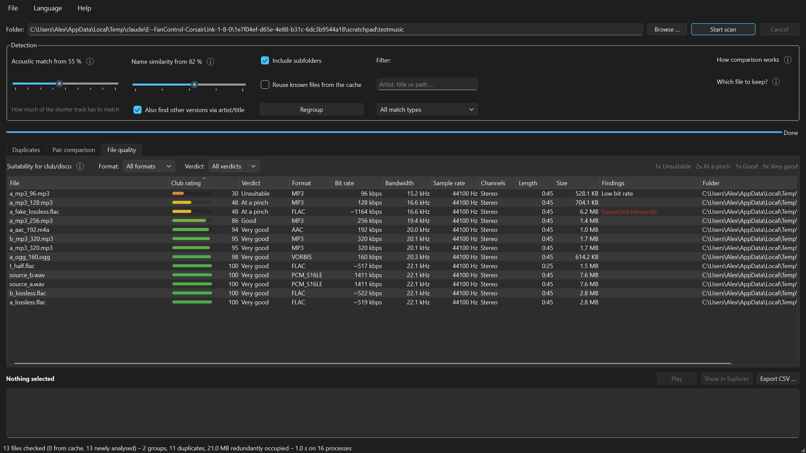
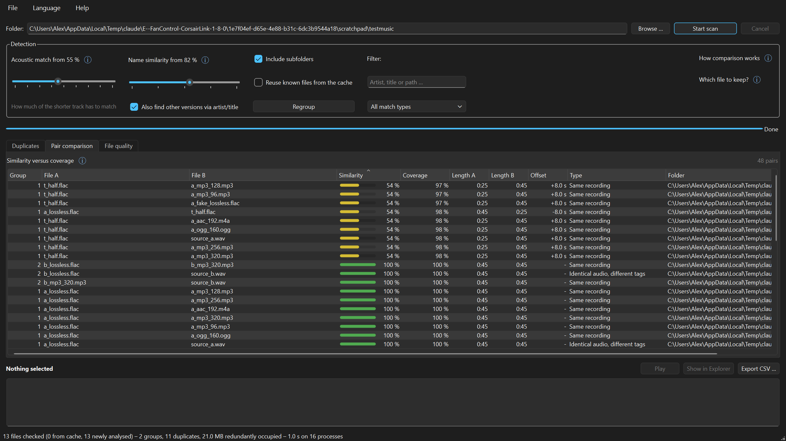

# MusicDupes

**Findet doppelte Musikdateien anhand ihres Klangs – nicht anhand der Tags.**

Erkennt dieselbe Aufnahme quer über Formate und Bitraten hinweg, misst, was
tatsächlich in jeder Datei steckt, und sagt dir, welche Kopie die bessere ist.

MusicDupes **verändert und löscht nichts**. Es ist ein reines
Anzeigewerkzeug. Löschen bleibt deine Entscheidung, im Explorer.

[English version of this page](README.md) · Windows · MIT-Lizenz



---

## Warum noch ein Duplikatfinder

Die meisten Werkzeuge vergleichen Dateinamen, Tags oder Prüfsummen. Damit
übersehen sie denselben Track als FLAC und als MP3, und sie können nicht
sagen, welche von zwei Kopien sich zu behalten lohnt.

MusicDupes macht zwei Dinge anders.

**Es vergleicht den Ton.** Jede Datei wird einmal dekodiert und auf einen
akustischen Fingerabdruck reduziert. Eine MP3 mit 320 kbps und ihr
FLAC-Original werden so als dieselbe Aufnahme erkannt, auch wenn die Tags
völlig verschieden sind.

**Es misst die Qualität, statt sie abzulesen.** Die Spalte *Bandbreite* wird
aus dem Tonsignal gewonnen, nicht aus den Tags. Das deckt auf, was kein Tag
verrät: eine FLAC, die aus einer MP3 erzeugt wurde. Sie belegt den Platz einer
verlustfreien Datei und klingt trotzdem wie die MP3, aus der sie stammt – in
dem Fall ist die **größere** Datei die schlechtere.

| gemessene Bandbreite | entspricht etwa |
|---|---|
| 15–16 kHz | 96–128 kbps |
| 19–20 kHz | 256–320 kbps |
| über 20 kHz | verlustfrei oder sehr hohe Bitrate |

---

## Loslegen

### Einzeldatei – herunterladen und starten (empfohlen)

1. **`MusicDupes.exe`** unter [Releases](../../releases/latest)
   herunterladen.
2. Doppelklicken.

Das ist alles. Eine Datei, rund 125 MB, keine Installation, kein Entpacken,
kein Python, kein FFmpeg – alles steckt drin. Läuft auch vom USB-Stick.

Jeder Start dauert etwa eine Sekunde länger als bei der Ordnerfassung, weil
sich das Programm in einen Temp-Ordner auspackt; der verschwindet beim
Beenden wieder. Seine eigenen Daten – den Analyse-Cache und deine
Einstellungen – legt es in einem Ordner `data` neben der Datei ab.

### Portable-Ordner – etwas schneller, Bibliotheken austauschbar

`MusicDupes-Portable.zip` herunterladen, **vorher entsperren** (Rechtsklick
→ Eigenschaften → *Zulassen*), entpacken und `MusicDupes.exe` im Ordner
starten. Startet in rund 0,3 statt 1,5 Sekunden.

Das ist auch die Fassung, wenn du die mitgelieferten Qt- oder
FFmpeg-Bibliotheken austauschen willst, wozu dich die LGPL berechtigt – in
der Ordnerfassung sind das gewöhnliche Dateien.

### Microsoft Store – geplant

Eine Store-Fassung ist vorbereitet (`packaging/`) und wird hier verlinkt,
sobald der Eintrag online ist. Store-Pakete signiert Microsoft selbst,
Windows zeigt dafür überhaupt keine Warnung.

### Sprache

Die Sprache folgt der Windows-Einstellung: Deutsch auf deutschsprachigen
Systemen (DE, AT, CH), sonst Englisch. Umstellen lässt sie sich unter
*Sprache*; die Wahl gilt ab dem nächsten Start.

### Ist das sicher? Warum Windows warnen kann

Beim ersten Start kann Windows **„Der Computer wurde durch Windows
geschützt“** anzeigen. Das heißt nicht, dass in der Datei etwas gefunden
wurde – Windows zeigt die Meldung bei Programmen, die es noch selten gesehen
hat. Weiter über *Weitere Informationen → Trotzdem ausführen*.

Jede Veröffentlichung wird von GitHub Actions aus dem markierten Quellstand
dieses Repositories gebaut und mit SHA-256-Prüfsummen ausgeliefert, mit
denen sich der Download prüfen lässt.

MusicDupes hat **keinerlei Netzwerkzugriff** und verändert oder löscht nie
eine Datei – siehe [Datenschutzerklärung](docs/privacy.md).

### Richtlinie zur Code-Signatur

Die Code-Signatur über [SignPath Foundation](https://signpath.org/), die
Open-Source-Projekte kostenlos signiert, ist im Release-Ablauf vorbereitet.
Sobald das Projekt freigegeben ist, werden die Veröffentlichungen dort
signiert – der private Schlüssel verlässt nie das Hardware-Modul von
SignPath – und tragen den Hinweis *Free code signing provided by
[SignPath.io](https://about.signpath.io/), certificate by
[SignPath Foundation](https://signpath.org/)*. Einzelheiten:
[Richtlinie zur Code-Signatur](docs/code-signing-policy.md).

---

## Die drei Reiter

### Duplikate

Gruppen von Dateien, die zusammengehören. Der mit `*` markierte, grün
hinterlegte Eintrag ist der Vorschlag zum Behalten.

Trefferarten, von sicher nach unsicher:

| Art | Was tatsächlich geprüft wurde |
|---|---|
| Identische Datei | Bit für Bit dieselbe Datei |
| Identischer Ton, andere Tags | Dekodierter Ton identisch, nur die Tags unterscheiden sich |
| Gleiche Aufnahme | Derselbe Ton, neu kodiert: anderes Format, andere Bitrate, anderer Rip oder Schnitt |
| Gleicher Titel, andere Aufnahme | Nur Interpret und Titel passen – meist Remix, Live oder Radio Edit |

Die letzte Art ist die unsichere. Sie steht in der Spalte „Treffer“ deshalb
als `Name 96 %` in Ocker und nicht als schlichte Prozentzahl – akustisch
haben solche Dateien oft nichts gemeinsam. Sie zählen auch nicht als
Duplikat und nicht zum „redundant belegten“ Platz.

### Paarvergleich



Dieselbe Messung, auf zwei Arten gelesen:

* **Deckung** teilt durch den **kürzeren** Track: *Wie viel davon steckt im
  längeren?*
* **Ähnlichkeit** teilt durch den **längeren** Track: *Wie sehr gleichen sich
  die Dateien insgesamt?*

Ein Original von 3:51 gegen seinen Extended Mix von 6:32 hat hohe Deckung,
aber nur mittlere Ähnlichkeit. Das Original steckt fast vollständig im
Extended, der Extended enthält schlicht viel mehr.

Zum Finden von Duplikaten taugt die Deckung, zum Beurteilen die Ähnlichkeit.

### Dateiqualität

Alle eingelesenen Dateien, ob doppelt oder nicht, mit einem Balken von rot
nach grün für die Eignung auf einer großen Anlage. Sortierbar nach jeder
Spalte, filterbar nach Format und Bewertung.

| Bewertung | ab | entspricht etwa |
|---|---|---|
| Sehr gut | 88 | verlustfrei oder volle Bandbreite |
| Gut | 70 | ab 256 kbps |
| Brauchbar | 50 | um 192 kbps |
| Notfalls | 30 | um 128 kbps, hörbar dumpf |
| Ungeeignet | – | auf großer Anlage peinlich |

---

## Wie erkannt wird

Jede Datei wird **einmal** dekodiert. Fingerabdruck und Qualitätsdaten
entstehen aus demselben Spektrogramm – zweimal dekodieren wäre die halbe
Geschwindigkeit.

Der Vergleich läuft danach in zwei Stufen.

**1. Kandidatensuche.** Aus dem Spektrum werden markante Punkte gepickt und
paarweise zu Hashes verknüpft (Constellation-Verfahren). Ein invertierter
Index findet damit unter tausenden Dateien die wenigen Verdächtigen, ohne
jede Datei mit jeder anderen zu vergleichen.

**2. Nachrechnung.** Nur die Kandidaten werden dicht verglichen: ein schmales
Bandprofil (16 Bänder, ~21 Bilder/s), per Kreuzkorrelation zeitlich
ausgerichtet und dann Bild für Bild geprüft – um ganze und um halbe Bilder
versetzt, damit auch eine um Bruchteile verschobene Datei noch genau passt.
Erst diese Zahl erscheint in der Oberfläche.

Die zweite Stufe ist nicht optional, sondern der Grund, warum die
Prozentzahl etwas taugt. Die Trefferzahl aus Stufe 1 hängt stark davon ab,
wie eine Datei zufällig auf das Analyseraster fällt: bei einem um ein halbes
Bild verschobenen Schnitt fällt dieselbe Aufnahme von 99 % auf 20 %. Der
dichte Vergleich kennt dieses Problem nicht.

Gemessen an einem Testsatz – eine Aufnahme als WAV, FLAC, MP3 96/128/256/320,
OGG, AAC, eine aus MP3 erzeugte FLAC, eine gekürzte Kopie, eine neben dem
Analyseraster gekürzte Kopie und eine mit 6 s zusätzlichem Vorlauf, dazu eine
zweite Aufnahme und zwei fremde Tracks:

* jede Kopie gegen den Behalten-Vorschlag: **97,6 % oder mehr**
* schwächstes Paar (zwei verschieden gekürzte Kopien untereinander):
  **85,4 %**
* stärkster Fehlalarm: **0,4 %**

> **Ehrlicher Vorbehalt:** Die Fehlalarm-Zahl stammt aus einem kleinen
> Testsatz. Eine echte Sammlung enthält Dinge, die darin fehlen – Tracks
> eines Albums mit gemeinsamem Drumloop, dasselbe Sample in zwei Songs,
> klassische Werke in mehreren Einspielungen. Rechne auf echtem Material mit
> einem knapperen Abstand. Deshalb steht die Voreinstellung streng auf 90 %.

### Welche Datei behalten?

Entschieden wird in dieser Reihenfolge – bewusst nicht über einen einzigen
Punktwert:

1. **Gemessene Bandbreite** (in 2-kHz-Stufen) – die einzige Angabe, die nicht
   lügen kann
2. **Echt verlustfrei** – ein Transcode-Verdacht zählt nicht als verlustfrei
3. Qualitätsscore
4. Dauer, dann Bitrate, dann Größe

Die Bandbreite steht vorn, weil sonst eine aus MP3 erzeugte FLAC ihr eigenes
Original allein über Format und Dateigröße schlagen würde. Der Score steht
nicht vorn, weil der Abzug für Übersteuerung – den lautgemasterte
Clubtracks praktisch immer kassieren – sonst eine verlustbehaftete Datei vor
eine FLAC schieben würde.

---

## Warum CPU und nicht die Grafikkarte

Die Arbeit besteht fast vollständig aus Audio-Dekodierung (FFmpeg) und vielen
kleinen FFTs – seriell, verzweigt, speichergebunden. Das ist das Gegenteil
dessen, was eine GPU schnell macht; die Daten wären noch über PCIe unterwegs,
wenn die CPU längst fertig ist.

Eine CPU mit 16 Threads lastet zuverlässig aus, danach begrenzt die
Festplatte. Zur Größenordnung: rund **2000 Tracks in wenigen Minuten** beim
ersten Durchlauf. Jeder weitere dauert etwa eine halbe Minute (2059 Tracks:
28 s), weil alle Analysen in `data\cache.db` liegen; *Neu gruppieren* nach
einer Reglerbewegung dauert rund fünf Sekunden.

---

## Unterstützte Formate

Alles, was das mitgelieferte FFmpeg dekodieren kann: MP3, FLAC, WAV,
M4A/AAC, ALAC, OGG/Vorbis, Opus, WMA, AIFF, APE, WavPack, Musepack, DSF, TTA,
AC3/EAC3 und mehr.

---

## Aus dem Quellcode bauen

Voraussetzung: Python 3.10 oder neuer unter Windows (die Veröffentlichungen
werden mit Python 3.14 und genau den Paketversionen aus
`requirements-build.txt` gebaut).

```
setup.bat
```

Danach einen `win64-lgpl-shared`-Build von
[BtbN/FFmpeg-Builds](https://github.com/BtbN/FFmpeg-Builds/releases) nach
`ffmpeg\` legen (den Inhalt seines `bin\`-Ordners) und starten:

```
build-portable.bat
```

Das erzeugt beide Auslieferungsformen – `dist-single\MusicDupes.exe` und
`dist\MusicDupes\`, gepackt als `MusicDupes-Portable.zip` – jeweils mit
SHA-256-Prüfsumme. Das Build-Skript warnt, wenn das gefundene FFmpeg ein
GPL-Build ist – siehe Abschnitt Lizenzen.

Ohne Bauen starten: `MusicDupes.bat`, oder auf der Kommandozeile:

```
MusicDupes-Konsole.bat --cli "D:\Musik" --csv ergebnis.csv
```

Weitere Schalter: `--audio 90` (akustische Schwelle), `--meta 82`
(Namensschwelle), `--no-metadata`, `--flat` (ohne Unterordner),
`--lang de|en|auto`. Dieselben Schalter versteht auch die veröffentlichte
`MusicDupes.exe`; als Fensterprogramm gibt sie aber nichts aus – das
Ergebnis kommt dann über `--csv`.

---

## Lizenzen

MusicDupes steht unter der **MIT-Lizenz** – siehe [LICENSE](LICENSE).

Beide Auslieferungsformen enthalten zusätzlich Python (PSF), NumPy (BSD),
Qt/PySide6 (**LGPL-3.0**) und FFmpeg (**LGPL-3.0**), jeweils unverändert. Im
Portable-ZIP liegen die LGPL-Teile als eigenständige, austauschbare Dateien
bei, wie es die LGPL vorsieht; die Lizenztexte (einschließlich der GPL-3.0,
auf der die LGPL aufbaut) stehen in `licenses\`. Einzelheiten:
[THIRD-PARTY-LICENSES.md](THIRD-PARTY-LICENSES.md).

Der FFmpeg-Build ist bewusst **LGPL und nicht GPL**: MusicDupes dekodiert
nur, die GPL-Teile (x264, x265, Xvid) werden nicht gebraucht. Mit einem
GPL-FFmpeg fiele das ganze Paket unter die GPL.

PyInstaller steht unter der GPL-2.0 **mit Bootloader-Ausnahme**, die die
Weitergabe des gebauten Programms unter jeder Lizenz ausdrücklich erlaubt –
es legt MusicDupes also nichts auf.

---

## Bekannte Grenzen

* **Nur Windows.** Die Erkennung ist portables Python, aber Verpackung,
  `explorer /select` und die FFmpeg-Beigabe sind auf Windows zugeschnitten.
* **Die Fehlalarm-Rate ist nicht an einer großen echten Sammlung
  gemessen** – siehe Vorbehalt oben.
* Tracks unter etwa einer Sekunde werden nicht erkannt; zu wenig zum
  Vergleichen.
* Dateien über 20 Minuten werden bis dahin analysiert. Für die Erkennung
  reicht das bei weitem, und es begrenzt den Speicher je Worker.
* Der Vergleich geht von **einem gleichbleibenden Zeitversatz** zwischen zwei
  Dateien aus. Ein vorangestelltes Intro ist kein Problem; fügt eine Fassung
  mittendrin Takte ein, passt alles danach nicht mehr.

## Mitmachen

Issues und Pull Requests sind willkommen. Tests, die den Namen verdienen,
gibt es noch nicht – das ist der nützlichste Einstieg.
